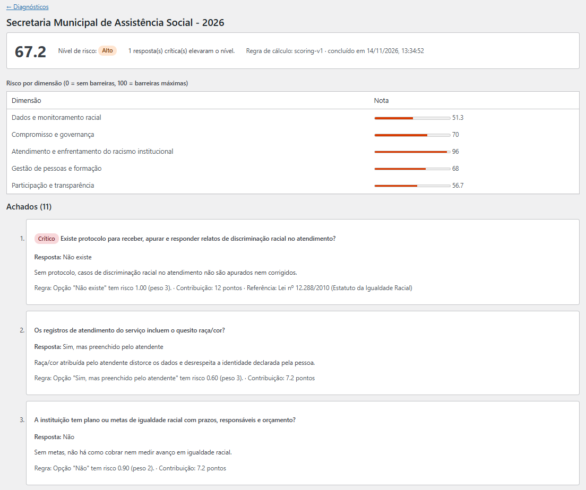
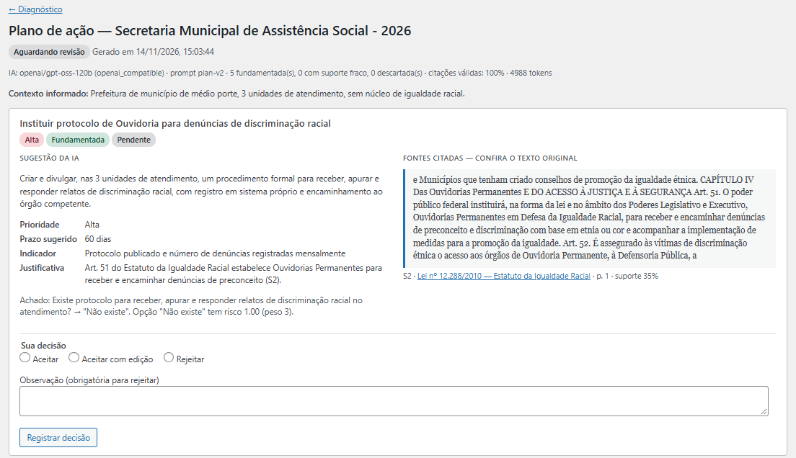
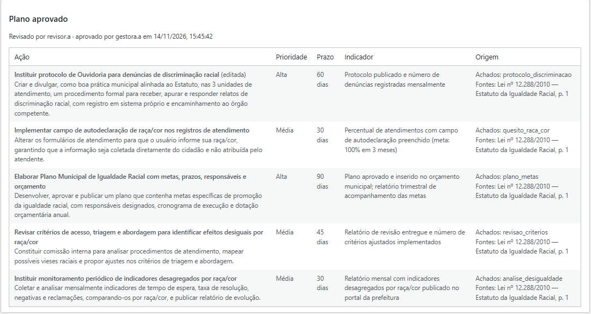

# EquiGov AI

[](https://github.com/megusta01/equigov-ai/actions/workflows/ci.yml)

Plataforma para órgãos públicos **diagnosticarem riscos de desigualdade racial e barreiras de acesso** nos seus serviços e montarem **planos de ação** com apoio de IA, em que cada sugestão é **rastreável até o trecho da norma que a fundamenta** e só vale depois de **revisão e aprovação por duas pessoas diferentes**.

> Projeto independente de portfólio, desenvolvido por Gustavo Figueredo, inspirado nos problemas que iniciativas como a INCLUA – Igualdade Racial (Ipea/MIR) buscam enfrentar. Não tem vínculo com nenhum órgão público nem reproduz seus instrumentos.

<!-- Capturas: salve em docs/img/ com estes nomes -->
| Diagnóstico | Revisão com a fonte ao lado | Plano aprovado |
|---|---|---|
|  |  |  |

## O problema

Um serviço público pode ser formalmente aberto a todos e, na prática, reproduzir desigualdades raciais: sem o quesito raça/cor nos registros, ninguém vê se pessoas negras esperam mais ou têm mais pedidos negados; sem protocolo, casos de discriminação não são apurados. O mesmo vale para outras barreiras, como canal só digital, falta de atendimento em Libras ou linguagem inacessível. Gestores raramente têm um instrumento para medir esses riscos e ligar cada um à norma correspondente e a uma medida concreta.

Dois questionários acompanham o projeto: **maturidade institucional em igualdade racial** (dados raciais, governança, enfrentamento do racismo institucional, formação, participação) e **acesso inclusivo a serviços públicos**. Novos questionários são arquivos JSON versionados, sem código.

## O que o sistema faz

```
Gestor responde o questionário ─▶ pontuação determinística e explicável (sem IA)
        │                           cada achado mostra regra, referência legal e quantos pontos pesou
        ▼
Gestor pede sugestões ─▶ busca nas normas por achado ─▶ LLM propõe ─▶ verificador confere cada citação
        │
        ▼
Revisor decide cada sugestão (aceitar · editar · rejeitar), lendo o trecho original da norma ao lado
        │
        ▼
Outro gestor aprova ou rejeita (quem participou da revisão não aprova) ─▶ plano final com a origem de cada ação
```

Tudo vai para a trilha de auditoria: modelo, versão do prompt, métricas de verificação e tokens da geração; cada decisão humana; quem revisou e quem aprovou.

## Resultados verificáveis

| | |
|---|---|
| **Testes** | 70 PHPUnit · 60 pytest · 66 verificações de integração contra WordPress + MariaDB + IA reais · E2E em navegador (Playwright) |
| **Busca nas normas** | hit@1 = 0,952 em 21 casos anotados (20 acertos em primeiro lugar), 9 deles sobre o Estatuto da Igualdade Racial |
| **Geração** | plano real com 100% das citações válidas, cerca de 3,2 mil tokens e 3 s por plano (Groq, plano gratuito) |
| **CI** | lint, unitários, integração, E2E, varredura de segredos, auditoria de dependências e build das imagens a cada push |

Detalhes e a revisão manual que levou ao prompt `plan-v2`: [`ai-service/README.md`](ai-service/README.md#avaliação).

## Stack

| Camada | Tecnologia |
|---|---|
| Aplicação | WordPress 6 + plugin próprio (PHP 8.3, PSR-4, sem dependências em produção) |
| Banco | MariaDB 11.4 (tabelas próprias, transações, schema versionado) |
| API | WordPress REST API, namespace `equigov/v1` |
| Interface | JavaScript puro no painel do WordPress, com práticas de acessibilidade (rótulos, foco visível, contraste, aria-live) |
| IA | Python 3.12, FastAPI, BM25 + embeddings locais (fastembed), SQLite, LLM por API compatível com OpenAI (Groq) |
| Infraestrutura | Docker Compose (Nginx, PHP-FPM, MariaDB, serviço de IA) |
| Qualidade | PHPUnit, pytest, Playwright, ruff, actionlint, gitleaks, composer audit, pip-audit, GitHub Actions |

## Rodando localmente

Requisito: Docker (Docker Desktop no Windows/macOS). Chave gratuita do Groq em console.groq.com para a geração real; sem ela, use `LLM_PROVIDER=fake`.

```powershell
# Windows (PowerShell)                      # Linux/macOS: make <tarefa>
.\tasks.ps1 install     # cria .env, sobe containers, instala WP, ativa o plugin, cria dados de demonstração
.\tasks.ps1 ai-ingest   # indexa as normas de ai-service/corpus
.\tasks.ps1 test        # PHPUnit
.\tasks.ps1 ai-test     # pytest
.\tasks.ps1 smoke       # integração de ponta a ponta
```

Abra `http://localhost:8080/wp-admin` → menu **EquiGov**. Usuários de demonstração (senha `demo-equigov-2026`): `gestora.a`, `revisor.a`, `leitor.a` (Instituição A) e `gestor.b` (Instituição B).

## Documentação

| Documento | Conteúdo |
|---|---|
| [Arquitetura](docs/arquitetura.md) | Componentes, modelo de dados, fluxos e estados (diagramas Mermaid) |
| [Decisões (ADRs)](docs/adr/README.md) | 8 decisões com alternativas e consequências |
| [API REST](docs/api.md) | Autenticação, autorização, erros, regra de pontuação, exemplos |
| [Serviço de IA](ai-service/README.md) | RAG, verificador de citações, avaliação |
| [Segurança e LGPD](docs/seguranca.md) | Ameaças, controles e os testes que os cobrem |
| [Runbook](docs/runbook.md) | Operação, saúde, logs, problemas conhecidos, backup |
| [Estudos de caso](docs/estudos-de-caso.md) | Falhas reais encontradas: causa, correção e teste de regressão |

## Estrutura

```
├── wordpress/plugins/equigov-core/   plugin: domínio, API, interface, testes (unit, smoke, e2e)
├── ai-service/                       serviço de IA: app, testes, acervo de normas (corpus/)
├── infrastructure/                   Nginx, PHP-FPM, scripts de bootstrap
├── docs/                             arquitetura, ADRs, API, segurança, runbook, estudos de caso
├── .github/workflows/ci.yml          pipeline
├── docker-compose.yml
└── tasks.ps1 · Makefile              atalhos de operação
```

## Limitações e próximos passos

- **Geração síncrona** limitada a 55 s; próximo passo: fila assíncrona (Action Scheduler) com notificação.
- **Verificador por sobreposição de termos** não detecta generalização de escopo; próximo passo: checagem de implicação por um segundo modelo. A revisão humana cobre essa lacuna.
- **Acervo inicial** de 6 normas federais; não cobre, por exemplo, canais exclusivamente digitais. Ampliar com normas estaduais, municipais e guias técnicos.
- **Painéis de acompanhamento** (evolução do risco por instituição, execução das ações) e **área de formação** ficaram fora deste MVP.
- Produção exigiria HTTPS, *rate limiting* na borda e plano pago do provedor de LLM.

## Licença

GPL-2.0-or-later, como exigido para plugins WordPress.
