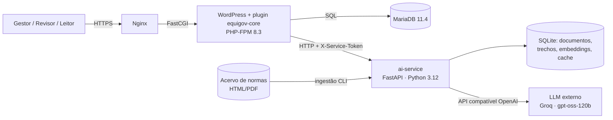
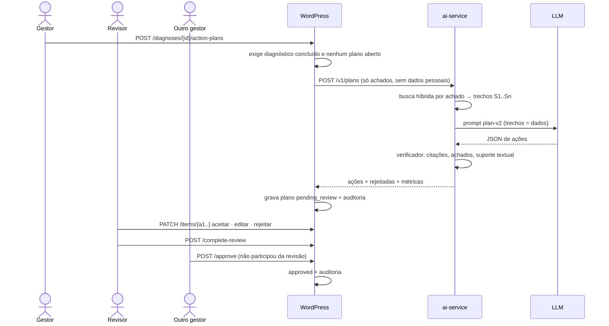
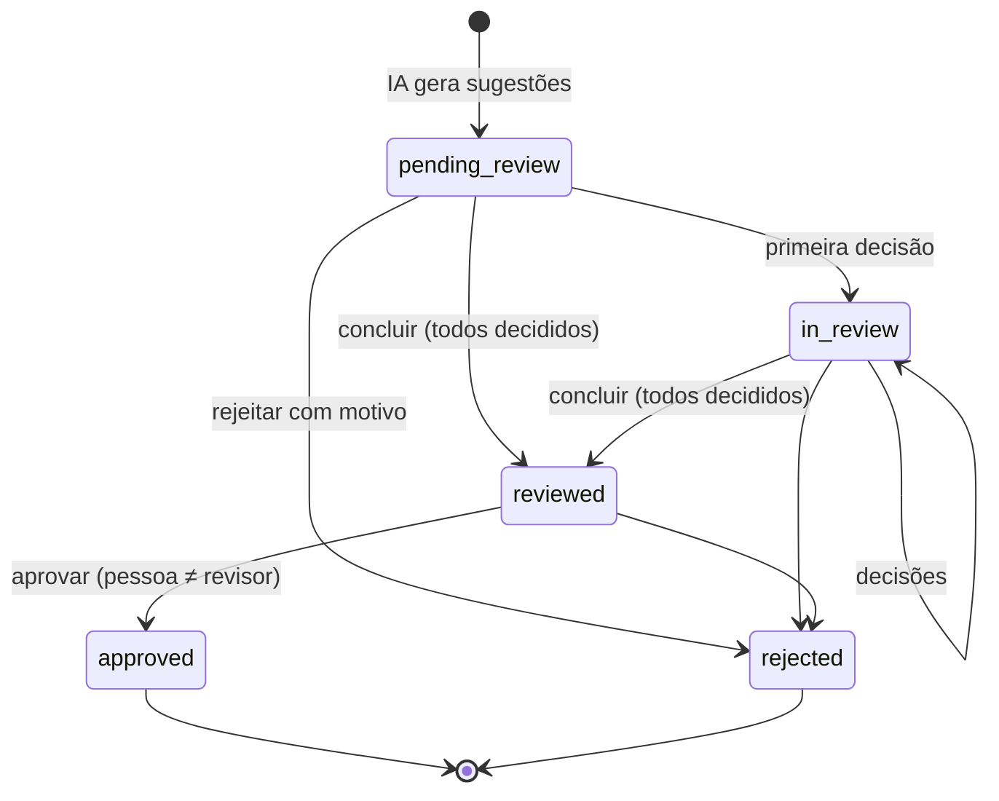

# Arquitetura

## Visão geral



| Componente | Responsabilidade | Não faz |
|---|---|---|
| **Nginx** | Única porta exposta; cabeçalhos de segurança; bloqueia `xmlrpc.php`, `.env`, PHP em `uploads/` | Lógica de aplicação |
| **WordPress + `equigov-core`** | Usuários, papéis, isolamento por instituição, questionários, diagnóstico e pontuação, fluxo do plano de ação, auditoria, API REST, interface | Chamar o LLM diretamente |
| **MariaDB** | Fonte da verdade: diagnósticos, respostas, planos, decisões, auditoria | — |
| **ai-service** | Ingestão de normas, busca híbrida, geração com citações, verificação | Decidir nada: só sugere |
| **LLM externo** | Redigir sugestões a partir de achados e trechos | Ver dados pessoais ou da instituição |

A IA fica **fora do caminho crítico**: se o serviço ou o provedor cair, diagnósticos, relatórios e planos já existentes continuam funcionando.

## Plugin `equigov-core`

```
src/
├── Plugin.php                 composition root: único lugar que registra hooks
├── Installer.php              schema versionado (dbDelta) e papéis
├── Auth/                      Roles (RBAC), InstitutionPolicy (pura), InstitutionScope (map_meta_cap)
├── PostTypes/Registrar.php    CPTs, taxonomia, metadados com sanitização
├── Diagnosis/                 QuestionnaireSchema, ConditionEvaluator, AnswerValidator, ScoringEngine (puros) + DiagnosisService
├── ActionPlan/                PlanWorkflow (puro) + ActionPlanService
├── Ai/AiClient.php            cliente HTTP do ai-service
├── Api/                       controllers REST + Permissions
├── Repositories/              SQL com prepare()
├── Audit/AuditLogger.php      trilha append-only
├── Admin/AdminPage.php        tela "EquiGov" (app em assets/admin.js)
└── Cli/SeedCommand.php        wp equigov seed
```

Padrão aplicado em todo o plugin: **regra de negócio em classe pura** (testável sem WordPress, com PHPUnit) + **classe fina** que conecta ao WordPress.

## Modelo de dados

| Onde | O quê | Por quê |
|---|---|---|
| CPT `eg_questionnaire` | Questionário (schema JSON versionado em `_eg_schema`); dois incluídos: igualdade racial e acesso inclusivo | Conteúdo editorial: revisões, lixeira, editor |
| CPT `eg_diagnosis` | Diagnóstico + **snapshot do schema** + resultado | Snapshot: editar o questionário não altera diagnósticos antigos |
| CPT `eg_action_plan` | Itens (texto original da IA + versão final + decisão), resposta completa da IA, status | Rastreabilidade integral |
| Tabela `eg_responses` | Uma linha por resposta; `UNIQUE (diagnosis_id, question_key)` | Volume e upsert; postmeta não serve |
| Tabela `eg_audit_log` | Eventos com usuário, instituição, contexto JSON, IP em HMAC | Append-only, índices por instituição/data e objeto |
| Tabela `eg_institutions` | Órgãos | Escopo de isolamento |
| User meta `eg_institution_id` | Vínculo usuário → instituição | |

Diagnósticos e planos têm `show_ui => false`: só mudam pela API, onde estão validação, máquina de estados e auditoria.

## Fluxo de geração e aprovação do plano



## Estados



## Serviço de IA

Detalhes em [`ai-service/README.md`](../ai-service/README.md). Em resumo: extração por página (página = unidade de citação), trechos que não cruzam páginas e preferem cortar antes de `Art.`, BM25 + embeddings locais fundidos por RRF, prompt versionado, verificador de citações e cache por hash.

## Decisões

Registradas como ADRs em [`docs/adr/`](adr/README.md).
